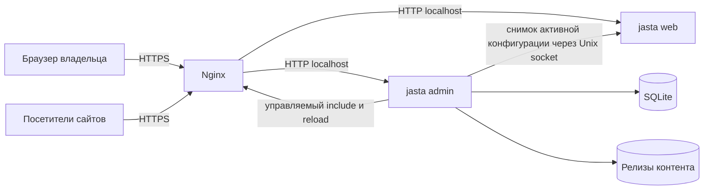

# Jasta

Jasta — сервис для публикации и раздачи статических сайтов. Он обслуживает сайты через Nginx, а управлять конфигурацией, доменами, сертификатами и версиями контента можно через локальную веб-админку.

## Содержание

- [Возможности](#возможности)
- [Как это устроено](#как-это-устроено)
- [Требования](#требования)
- [Локальный запуск](#локальный-запуск)
- [Разработка и проверки](#разработка-и-проверки)
- [Production-развёртывание](#production-развёртывание)
- [Безопасность и ограничения](#безопасность-и-ограничения)
- [Резервное копирование](#резервное-копирование)
- [Лицензия](#лицензия)

## Возможности

- Четыре типа сайтов:
  - **SPA** — для маршрутов без отдельного файла отдаёт главный `index.html`.
  - **MPA** — обслуживает файлы и `index.html` соответствующего URL-каталога.
  - **Markdown** — собирает Markdown-файлы с YAML front matter в HTML через Go-шаблоны.
  - **Redirect** — перенаправляет запросы на другой URL с сохранением пути и query string; поддерживаются статусы 301 и 308.
- Загрузка ZIP и TAR.GZ архивов или получение архива из сохранённого HTTPS-источника.
- Черновые конфигурации, история релизов, активация и откат с восстановлением конфигурации релиза.
- Защищённая админка с локальным владельцем, паролем, обязательным TOTP и JWT-сессиями.
- Выпуск самоподписанных сертификатов для локальной разработки и сертификатов Let’s Encrypt через HTTP-01.
- Генерация принадлежащих Jasta конфигураций Nginx с проверкой перед reload.

## Как это устроено



`jasta web` обслуживает публичный контент и не подключается к SQLite. `jasta admin` управляет сайтами и релизами, хранит состояние в SQLite и передаёт активные конфигурации веб-процессу через локальный Unix-сокет. Переключение релиза не требует перезапуска `jasta web`.

В пакетной установке Nginx завершает HTTPS, а оба сервиса Jasta слушают localhost. Админка публикуется на отдельном домене.

## Требования

- Go **1.26.11** для сборки из исходников.
- C-компилятор и CGO для SQLite-драйвера.
- Node.js **22.12 или новее** (до версии 27) и pnpm **12.x** для сборки админки.
- Для production-развёртывания из `.deb`: Debian или Ubuntu, systemd и Nginx.
- Для сборки `.deb`: `goppy`, `deb-builder` и C-компилятор под целевую архитектуру. Для кросс-сборки arm64 на amd64 нужен `aarch64-linux-gnu-gcc`.

## Локальный запуск

Клонируйте репозиторий и перейдите в его каталог. Локальные примеры используют `config/config.dev.yaml`, `config/admin.dev.yaml`, каталог `test_data/` и временное хранилище в `/tmp`.

### 1. Настройте владельца

Выполните команду в интерактивном терминале **до запуска `jasta admin`**:

```bash
make run-owner-bootstrap-local
```

Команда создаст временный ключ и SQLite-базу для разработки, запросит пароль, покажет TOTP QR-код и попросит ввести код из приложения-аутентификатора. Сохраните выведенные recovery-коды: повторно показать их нельзя.

### 2. Запустите сервисы

Откройте два терминала. Сначала запустите web:

```bash
make run-web-local
```

Затем в другом терминале запустите admin:

```bash
make run-admin-local
```

Админка будет доступна по адресу <http://127.0.0.1:8090/>. Войдите с паролем владельца и кодом TOTP. Остановить каждый сервис можно сочетанием `Ctrl+C` в его терминале.

Для повторной настройки владельца остановите admin и запустите `jasta admin owner-reset`, затем снова выполните bootstrap. Сброс отзывает все сессии владельца.

## Разработка и проверки

Собранные файлы админки включаются в бинарник Jasta. После изменения frontend пересоберите их:

```bash
cd ui/admin
pnpm install --frozen-lockfile
pnpm lint
pnpm build
```

Из корня репозитория:

```bash
go test ./...
mkdir -p build
go build -o ./build/jasta ./cmd/jasta
```

Для запуска через Makefile доступны команды `make run-web-local`, `make run-admin-local` и `make run-owner-bootstrap-local`. `make lint` и `make tests` используют `goppy`.

## Production-развёртывание

Проект содержит сборку Debian-пакетов для amd64 и arm64:

```bash
make deb
```

Пакет устанавливает отдельные systemd-службы `jasta-web.service` и `jasta-admin.service`, конфигурационные файлы и Nginx shim. Основные production-конфиги находятся в `/etc/jasta/config.yaml` и `/etc/jasta/admin.yaml`; данные admin по умолчанию хранятся в `/var/lib/jasta/`.

Перед публикацией настройте `nginx.admin_domain`, ACME contact email и принятие условий Let’s Encrypt в `admin.yaml`. Для HTTP-01 challenge домен должен указывать на сервер, а входящий порт 80 должен быть доступен. После установки создайте владельца интерактивной командой:

```bash
sudo systemctl stop jasta-admin.service
sudo jasta admin owner-bootstrap
sudo systemctl start jasta-admin.service
```

Проверяйте состояние служб и Nginx после установки или изменения сетевых настроек:

```bash
sudo systemctl status jasta-web.service jasta-admin.service nginx
sudo nginx -t
```

## Безопасность и ограничения

- Админка рассчитана на публикацию за HTTPS через Nginx; её HTTP listener должен оставаться локальным.
- Владелец входит по паролю и TOTP. Access JWT краткоживущий; refresh-сессия передаётся через защищённую HttpOnly cookie.
- Ключ шифрования данных admin хранится отдельно от SQLite. Сохраняйте его вместе с базой и релизами при резервном копировании.
- Источники архивов принимают только внешние HTTPS URL. Доступны публичные источники, HTTP Basic, Bearer и URL с query-подписью.
- Начальные лимиты архива — 100 MiB на загрузку и 1 GiB распакованного содержимого; лимиты настраиваются.
- Сертификаты Let’s Encrypt выпускаются через HTTP-01; wildcard-сертификаты не поддерживаются.
- Все релизы сохраняются до ручного удаления.

## Резервное копирование

Следуйте процедуре согласованного backup/restore, включая SQLite, релизы, конфиги и ключи:

- [Ручное резервное копирование и восстановление](docs/backup-restore.md)

## Лицензия

Jasta распространяется на условиях **GNU General Public License v3.0**. См. [LICENSE](LICENSE).
